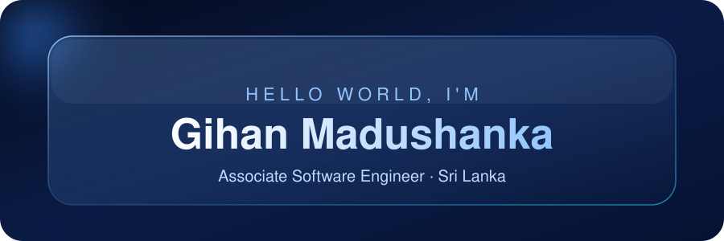

<div align="center">



<a href="https://git.io/typing-svg"></a>


</div>

---

## ⚡ About Me

```java
public class Gihan {
    String role     = "Associate Software Engineer";
    String location = "Sri Lanka 🇱🇰";
    String[] focus  = {"Java", "NestJS", "React", "Angular", "Cloud-native"};
    String mindset  = "Clean code. Solid architecture. Ship it.";
}
```

- 💬 Ask me about **Java**, backend architecture, and full-stack development
- 🛠️ I build across the stack: Java and NestJS on the server, React and Angular on the client
- 🐳 I deploy with **Docker** and **Kubernetes**
- 📫 Reach me: **gihanm729@gmail.com**
- 😄 Fun fact: I think I'm funny

---

## 🧰 Tech Stack

<div align="center">

</div>

<table align="center">
<tr>
<td align="center" width="25%"><b>⚙️ Backend</b><br/><sub>Java · NestJS · Node.js</sub></td>
<td align="center" width="25%"><b>🎨 Frontend</b><br/><sub>React · Angular · HTML · CSS · JS</sub></td>
<td align="center" width="25%"><b>🗄️ Databases</b><br/><sub>PostgreSQL · MySQL · MongoDB</sub></td>
<td align="center" width="25%"><b>☁️ DevOps & Design</b><br/><sub>Docker · Kubernetes · Figma · Photoshop</sub></td>
</tr>
</table>

---

## 📊 GitHub Stats

<div align="center">


</div>

---

## 🌐 Connect With Me

<div align="center">

<a href="mailto:gihanm729@gmail.com"></a>
<a href="https://linkedin.com/in/YOUR-LINKEDIN-ID"></a>
<a href="https://instagram.com/gi.h.an"></a>
<a href="https://fb.com/YOUR-FACEBOOK-ID"></a>
<a href="https://www.hackerrank.com/YOUR-HACKERRANK-ID"></a>

<br/><br/>


</div>
